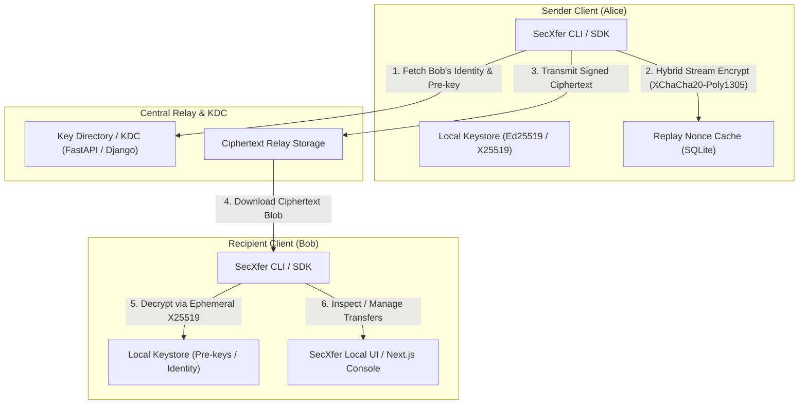

# SecXfer

> Client-side encrypted file-transfer security engineering project.

SecXfer explores a three-layer file-transfer architecture in which cryptographic operations occur in a local client service while the central server primarily stores and transports ciphertext.

The implementation uses established cryptographic primitives through maintained libraries such as PyNaCl/libsodium and PyCA rather than implementing encryption algorithms from scratch.

The surrounding **protocol composition, session-establishment flow, replay-handling design, key-management workflow, and application integration are project-designed and have not undergone an independent cryptographic audit or formal verification**.

SecXfer should therefore be treated as a security-engineering and academic project, **not as audited production cryptographic software**.

---

## Architecture & Component Responsibilities

SecXfer decouples identity and cryptographic trust from centralized transport infrastructure across three distinct functional tiers:



### Component Breakdown

1. **Client Core & CLI (`src/secxfer/`):**
   - **Cryptographic Engine (`crypto.py`):** Ephemeral X25519 Diffie-Hellman key exchange, HKDF-SHA256 key derivation, XChaCha20-Poly1305 AEAD chunked streaming (`secretstream`), and Ed25519 signatures.
   - **Local Keystore (`keystore.py`):** On-disk storage for private identity keys, one-time pre-keys, and pinned peer public identities.
   - **Replay Protection (`transfer.py`):** Persistent SQLite-backed sliding-window nonce tracking and TTL expiration preventing replay attacks.
   - **Client SDK & CLI (`client.py`, `cli.py`):** High-level client interface providing command-line dispatch, identity lifecycle management, and optional Tor SOCKS5 proxy routing.
2. **Central Key Directory & Relay (`src/secxfer_server/` / `secxfer_django/`):**
   - **Key Distribution (KDC):** Public identity registry and one-time ephemeral prekey reservation (X3DH pattern) with atomic consumption guards.
   - **Zero-Knowledge Ciphertext Relay:** Accepts and serves encrypted payload streams. The central server has zero access to private keys or unencrypted plaintext.
   - **Audit Ledger:** Append-only SHA-256 hash-chained event logs for cryptographic auditability.
3. **User Experience & Management (`secxfer_nextjs/` / `src/secxfer/ui/`):**
   - **Local Dashboard:** FastAPI/uvicorn-backed local web interface for visual file transfer and identity management.
   - **Next.js Dashboard:** Client dashboard for viewing transfer activity, pre-key reserves, and contact identity states.
   - **Out-of-Band QR Verification (`segno`):** Terminal-rendered QR codes encoding public identity fingerprints for side-channel key pinning.

---

## Prerequisites & Installation

### Prerequisites
- **Python**: `>= 3.11` (tested on Python 3.11, 3.12, and 3.13)
- **C Compiler / libsodium**: Handled automatically via `PyNaCl` binary wheels on standard platforms.

### Installation

Clone the repository and install in editable mode:

```bash
# 1. Clone repository
git clone https://github.com/TM-threemavithana/secxfer.git
cd secxfer

# 2. Create virtual environment
python -m venv .venv
# On Linux/macOS:
source .venv/bin/activate
# On Windows:
.venv\Scripts\activate

# 3. Install core dependencies with testing and UX extras
pip install -e ".[dev,ux]"

# (Optional) Install server dependencies (FastAPI, Django, SQLAlchemy, Uvicorn)
pip install -e ".[dev,server,ux]"
```

---

## Verified Quickstart

Follow this step-by-step walkthrough to generate identities, inspect fingerprints, and pin peers.

### 1. Generate Local Identity Keypairs
Create an identity directory with an Ed25519 (signing) and X25519 (key exchange) keypair:

```bash
secxfer keygen --dir ./alice_keys --name alice
```
*Output:*
```text
Generated keypair in /path/to/alice_keys/
  Private key : alice_keys/alice.key  (keep secret)
  Public key  : alice_keys/alice.pub  (share with peers)
  Key ID      : 4f9e1b2c8a...
```

### 2. Inspect Key Fingerprint
Display the key ID and hex-encoded public keys:

```bash
secxfer show-id --identity ./alice_keys/alice.key
```

### 3. Display Terminal QR Code for Out-of-Band Verification
Render an ASCII QR code directly in the terminal to verify the identity key out-of-band:

```bash
secxfer qr show --identity ./alice_keys/alice.key
```

### 4. Register Identity with Central Key Server
Publish the public identity and upload one-time prekeys to a running KDC server:

```bash
secxfer register --identity ./alice_keys/alice.key --server http://127.0.0.1:8000
```

### 5. Fetch and Pin a Peer Identity
Fetch a peer's public identity from the KDC by key ID and pin it into the local keystore:

```bash
secxfer pin --key-id <BOB_KEY_ID> --name bob --server http://127.0.0.1:8000 --keystore ./alice_keys
```

### 6. Start the Local Web UI Dashboard
Launch the local web dashboard to manage identities and transfers visually:

```bash
secxfer ui --port 8085 --identity alice --keystore ./alice_keys
```
Open `http://localhost:8085` in your browser.

---

## CLI Command Reference

The `secxfer` executable provides subcommands mapped directly to core protocol operations:

| Command | Arguments | Description |
|---|---|---|
| `keygen` | `--dir DIR [--name NAME]` | Generates X25519 and Ed25519 private (`.key`) and public (`.pub`) key files. |
| `show-id` | `--identity KEY` | Prints the 8-byte key ID and raw public keys for an identity. |
| `register` | `--identity KEY --server URL [--name NAME] [--keystore DIR]` | Uploads public identity and batches of one-time prekeys to the key server. |
| `pin` | `--key-id ID --name ALIAS --server URL --keystore DIR [--force]` | Queries server for peer identity, checks against existing pins, and saves to keystore. |
| `qr show` | `--identity KEY` | Generates a terminal-rendered QR code for out-of-band identity verification. |
| `ui` | `[--port PORT] [--identity NAME] [--keystore DIR] [--tor]` | Starts the local web management dashboard (defaults to port `8085`). |

---

## Test Commands & CI Matrix

### Running Tests Locally

SecXfer uses `pytest` with `pytest-asyncio` for unit and regression testing:

```bash
# Run all automated test suites
pytest -v

# Run a specific test suite
pytest tests/test_crypto_v1.py -v
pytest tests/test_server.py -v
pytest tests/test_v2_regressions.py -v
pytest tests/test_x3dh_concurrency.py -v
```

### Test Suite Coverage
- **`tests/test_crypto_v1.py`**: Validates deterministic HKDF derivation, secretstream chunk round-tripping, tamper detection (modified ciphertext, wrong keys, chunk reordering, truncation), and Ed25519 signatures.
- **`tests/test_server.py`**: Verifies FastAPI key registry upload, retrieval, and rate-limiting behavior.
- **`tests/test_v2_regressions.py`**: Guards streaming payload framing, trailer validation, password-encrypted identity serialization, and deniable payload handling.
- **`tests/test_x3dh_concurrency.py`**: Multi-process concurrency tests asserting atomic, single-consumption guarantees for one-time prekeys under race conditions.

### CI Matrix
Automated continuous integration is executed on every push and pull request to `master` via GitHub Actions ([`.github/workflows/ci.yml`](.github/workflows/ci.yml)):
- **Python Matrix**: 3.11, 3.12, 3.13 on `ubuntu-latest`.
- **Reporting**: Automated JUnit XML test artifact publishing.

---

## Security Properties

| Property | Mechanism | Status / Qualification |
|---|---|---|
| Confidentiality | XChaCha20-Poly1305 | Implemented using libsodium |
| Integrity | AEAD + Ed25519 | Implemented; application integration not independently audited |
| Authentication | Ed25519 proof of possession | Implemented at application level |
| Forward secrecy | Ephemeral X25519 session material | Intended property; depends on correct protocol implementation and key lifecycle |
| Replay mitigation | Persistent nonce tracking | Depends on integrity and persistence of local replay state |
| Optional PSK hardening | HMAC-SHA256 PSK mixing | Experimental additional secret-key hardening; **not claimed as verified general post-quantum security** |
| Server-side confidentiality | Client-side encryption | Designed so the central server stores ciphertext rather than private keys/plaintext |
| Audit tamper evidence | SHA-256 hash chain | Detects modification when compared against trusted state |

---

## Threat Model

The project primarily explores protection against:

- Plaintext disclosure following compromise of central storage
- Unauthorized modification of ciphertext
- Replay of previously observed transfers
- Accidental server-side storage of private encryption keys
- Misuse of identity material during transfer workflows

It does not claim complete protection against:

- Compromised client operating systems
- Malware reading plaintext or key material from process memory
- Traffic analysis
- Denial-of-service
- Compromised cryptographic dependencies
- Weaknesses in project-designed protocol composition

---

## Optional PSK Hardening

SecXfer can mix a pre-shared secret into session-derived key material using HMAC-SHA256.

If a sufficiently strong PSK is generated, distributed, and stored independently of the asymmetric exchange, it may provide additional secret material unavailable to an attacker who compromises only the public-key mechanism.

However:

- The construction has not undergone independent cryptographic review
- Secure PSK provisioning is an external assumption
- The mechanism is not a replacement for standardized post-quantum key-establishment algorithms
- The project does not claim formal or independently verified post-quantum security

For this reason, the feature is described as **optional PSK hardening**, not simply “Post-Quantum Resistance ✅”.

---

## Audit Status

SecXfer has **not undergone an independent cryptographic or security audit**.

Security statements in this repository describe intended properties and observed implementation behavior. They should not be interpreted as formal guarantees suitable for production deployment.

Independent review would be especially valuable for:

- Session establishment
- Identity binding
- Key lifecycle management
- Replay-state handling
- Protocol message construction
- Error handling
- Local-daemon trust assumptions

---

## Known Limitations

Important limitations include:

- A compromised client OS may access decrypted key material while the cryptographic service is running
- Plaintext remains accessible before encryption and after decryption
- Encrypted file sizes can leak approximate size information
- Traffic analysis remains possible
- Denial-of-service protection is limited
- SQLite-based development deployments can encounter write contention
- Replay protection depends on persistent local state
- The protocol composition has not been independently audited

Security issues and protocol concerns are welcome through the repository's security-reporting process.
