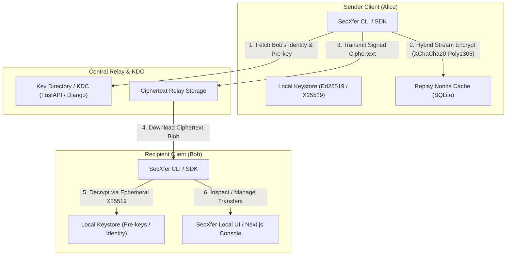

# SecXfer

> Client-side encrypted file-transfer security engineering project.

SecXfer explores a three-layer file-transfer architecture in which cryptographic operations occur in a local client service while the central server primarily stores and transports ciphertext.

The implementation uses established cryptographic primitives through maintained libraries such as PyNaCl/libsodium and PyCA rather than implementing encryption algorithms from scratch.

The surrounding **protocol composition, session-establishment flow, replay-handling design, key-management workflow, and application integration are project-designed and have not undergone an independent cryptographic audit or formal verification**.

SecXfer should therefore be treated as a security-engineering and academic project, **not as audited production cryptographic software**.

---

## Architecture & Component Responsibilities

SecXfer decouples identity and cryptographic trust from centralized transport infrastructure across three distinct functional tiers:



### Component Breakdown

1. **Client Core & CLI (`src/secxfer/`):**
   - **Cryptographic Engine (`crypto.py`):** Ephemeral X25519 Diffie-Hellman key exchange, HKDF-SHA256 key derivation, XChaCha20-Poly1305 AEAD chunked streaming (`secretstream`), and Ed25519 signatures.
   - **Local Keystore (`keystore.py`):** On-disk storage for private identity keys, one-time pre-keys, and pinned peer public identities.
   - **Replay Protection (`transfer.py`):** Persistent SQLite-backed sliding-window nonce tracking and TTL expiration preventing replay attacks.
   - **Client SDK & CLI (`client.py`, `cli.py`):** High-level client interface providing command-line dispatch, identity lifecycle management, and optional Tor SOCKS5 proxy routing.
2. **Central Key Directory & Relay (`secxfer_django/` / `src/secxfer_server/`):**
   - **Django KDC Infrastructure (`secxfer_django/`):** Enterprise zero-trust key distribution center with Ed25519 proof-of-possession challenge-response authentication (`/challenge`, `/register`), atomic prekey reservation (`/keys/{key_id}`), and SHA-256 append-only hash-chained audit logging (requires Python `>= 3.12`).
   - **FastAPI Key Directory (`src/secxfer_server/`):** Lightweight standalone key directory service for testing `/upload` bundle operations and unauthenticated `/keys/{key_id}` lookups (does not implement PoP `/challenge` or `/register` endpoints).
   - **Zero-Knowledge Ciphertext Relay:** Accepts and serves encrypted payload streams. The central server has zero access to private keys or unencrypted plaintext.
3. **User Experience & Management (`secxfer_nextjs/` / `src/secxfer/ui/`):**
   - **Local Web UI Dashboard (`src/secxfer/ui/`):** Local browser interface for managing transfers and keys.
   - **Next.js Console (`secxfer_nextjs/`):** Modern React dashboard for viewing transfer activity, pre-key reserves, and contact identity states.
   - **Out-of-Band QR Verification (`segno`):** Terminal-rendered QR codes encoding public identity fingerprints for side-channel key pinning.

---

## Prerequisites & Installation

### Python Version Support & Dependencies

SecXfer supports **Python 3.11, 3.12, and 3.13**. Note the installation guidance below based on your Python runtime:

> [!NOTE]
> **Django 6 Python Requirement:** The `[server]` extra includes `Django>=6.0,<7.0`, which officially requires **Python 3.12 or later**. If running on Python 3.11, install `[dev,ux]` and add standalone FastAPI server packages directly.

#### For Python 3.12 or 3.13:
Install the complete environment including development tools, UX tools, and the full Django 6 server extra:
```bash
# 1. Clone repository
git clone https://github.com/TM-threemavithana/secxfer.git
cd secxfer

# 2. Create virtual environment
python -m venv .venv
source .venv/bin/activate  # On Windows: .venv\Scripts\activate

# 3. Install core with dev, server (Django 6 + FastAPI), and UX extras
pip install --upgrade pip
pip install -e ".[dev,server,ux]"
```

#### For Python 3.11:
Install core libraries, development tools, UX tools, and the standalone FastAPI server packages (omitting Django 6):
```bash
# 1. Clone and create virtual environment
python -m venv .venv
source .venv/bin/activate  # On Windows: .venv\Scripts\activate

# 2. Install core, dev, and UX extras
pip install --upgrade pip
pip install -e ".[dev,ux]"

# 3. Install FastAPI key directory server dependencies
pip install fastapi "uvicorn[standard]" sqlalchemy "httpx[socks]" slowapi python-multipart
```

---

## Starting the Key Distribution Center (Django KDC)

SecXfer provides an enterprise zero-trust Key Distribution Center (KDC) in `secxfer_django/` (requires Python 3.12+). The KDC manages identity registration, Ed25519 proof-of-possession verification, one-time prekey reservation, and SHA-256 append-only hash-chained audit logging:

```bash
# 1. Configure environment
export DJANGO_SECRET_KEY="your-secure-development-secret-key"
export DJANGO_DEBUG="true"  # Enables local HTTP operation without SSL redirection

# 2. Apply database migrations
python secxfer_django/manage.py migrate

# 3. Initialize the challenge-cache table (required for proof-of-possession nonces)
python secxfer_django/manage.py createcachetable

# 4. Start the KDC server on port 8000
python secxfer_django/manage.py runserver 127.0.0.1:8000 --noreload
```

> [!NOTE]
> **Standalone FastAPI Directory Service (`src/secxfer_server/`):**  
> SecXfer also contains a lightweight standalone FastAPI service (`uvicorn secxfer_server.main:app --app-dir src --port 8000`) for development testing of bulk bundle uploads (`POST /upload`) and unauthenticated key lookups (`GET /keys/{key_id}`). It does **not** implement `/challenge` or `/register` endpoints and does not provide zero-trust proof-of-possession verification. The authenticated CLI workflow below requires the Django KDC.

---

## Verified Quickstart

Follow this step-by-step walkthrough to generate identities, register keys, and pin peer credentials.

### Step 1: Generate Local Identity Keypairs
Generate an identity keypair (X25519 encryption key, Ed25519 signing key) and prekeys in dedicated directories for Alice and Bob:

```bash
# Generate Alice's identity
secxfer keygen --dir ./alice_keys --name alice

# Generate Bob's identity
secxfer keygen --dir ./bob_keys --name bob
```
*Output creates `<name>.key` (private), `<name>.pub` (public), and `<name>_prekeys/` (one-time prekeys).*

### Step 2: Inspect Key Fingerprints
Display the 16-byte hexadecimal key ID (32 hexadecimal characters) and raw public keys:

```bash
secxfer show-id --identity ./alice_keys/alice.key
secxfer show-id --identity ./bob_keys/bob.key
```

### Step 3: Out-of-Band Fingerprint Verification (Terminal QR Code)
Render an ASCII QR code in the terminal to visually verify an identity out-of-band:

```bash
secxfer qr show --identity ./alice_keys/alice.key
```

### Step 4: Register Identities on the Key Server
Publish public keys and initial one-time prekeys to the running Django KDC:

```bash
# Register Bob's identity and prekeys
secxfer register --identity ./bob_keys/bob.key --server http://127.0.0.1:8000

# Register Alice's identity (prerequisite for zero-trust authenticated prekey access)
secxfer register --identity ./alice_keys/alice.key --server http://127.0.0.1:8000
```

### Step 5: Pin Peer Identity (Prerequisites & Command)

> [!IMPORTANT]
> **Prerequisites for Pinning a Peer Identity:**
> 1. Bob must have generated their identity keypair and prekeys (`secxfer keygen`).
> 2. Bob must have uploaded their public keys to the server (`secxfer register`).
> 3. Bob must share their 16-byte `key_id` (32 hexadecimal characters) with Alice out-of-band (from `secxfer show-id` or QR code).
> 4. **Zero-Trust Access Requirement:** The Django KDC requires the caller to prove possession of a registered identity (`--identity ./alice_keys/alice.key`) before dispensing a peer's one-time prekey. This defense prevents Prekey Exhaustion / Denial-of-Service attacks against Bob.

Once Bob and Alice are registered on the KDC, Alice pins Bob's public identity:

```bash
secxfer pin --identity ./alice_keys/alice.key --key-id <BOB_KEY_ID> --name bob --server http://127.0.0.1:8000 --keystore ./alice_keys/keystore
```

- **Output & Saved Key Material:**
  - `./alice_keys/keystore/bob.pub`: Bob's pinned identity public key (Curve25519 + Ed25519 + ML-KEM).
  - `./alice_keys/keystore/bob_prekeys/<prekey_id>.pub`: Bob's reserved one-time prekey for forward-secret session establishment.
- **Negative Authentication & Error Behavior:**
  - Omitting `--identity` against the zero-trust Django KDC returns HTTP 401 Unauthorized and terminates with CLI exit code `1`.
  - Querying an unknown or missing peer `key_id` returns HTTP 404 Not Found and terminates with CLI exit code `1`.

### Step 6: Launch Local Management Dashboard
Start the local web dashboard for visual key and transfer management:

```bash
secxfer ui --port 8085 --identity alice --keystore ./alice_keys/keystore
```
Open `http://localhost:8085` in your browser.

---

## CLI Command Reference

The `secxfer` executable provides subcommands mapped directly to core protocol operations:

| Command | Arguments | Description |
|---|---|---|
| `keygen` | `--dir DIR [--name NAME]` | Generates X25519/Ed25519 keypair and one-time prekeys directory. |
| `show-id` | `--identity KEY` | Prints the 16-byte key ID (32 hexadecimal characters), X25519 public key, and Ed25519 public key. |
| `register` | `--identity KEY --server URL [--name NAME] [--keystore DIR]` | Uploads public identity and unused prekeys to the key server. |
| `pin` | `--key-id ID --name ALIAS --server URL --keystore DIR [--identity KEY] [--force]` | Queries server for peer identity, validates pins, and saves to keystore. Requires `--identity` for authenticated Django KDC access. |
| `qr show` | `--identity KEY` | Generates a terminal-rendered QR code for out-of-band identity verification. |
| `ui` | `[--port PORT] [--identity NAME] [--keystore DIR] [--tor]` | Starts the local web management dashboard (defaults to port `8085`). |

---

## Test Commands & CI Matrix

### Running Tests Locally

SecXfer uses `pytest` with `pytest-asyncio` for unit and regression testing:

```bash
# Run all automated test suites
pytest -v

# Run individual test suites
pytest tests/test_crypto_v1.py -v
pytest tests/test_server.py -v
pytest tests/test_v2_regressions.py -v
pytest tests/test_x3dh_concurrency.py -v
```

### Test Suite Coverage
- **`tests/test_crypto_v1.py`**: Validates deterministic HKDF derivation, secretstream chunk round-tripping, tamper detection (modified ciphertext, wrong keys, chunk reordering, truncation), and Ed25519 signatures.
- **`tests/test_server.py`**: Verifies FastAPI key directory upload, retrieval, and rate-limiting behavior.
- **`tests/test_v2_regressions.py`**: Guards streaming payload framing, trailer validation, password-encrypted identity serialization, and deniable payload handling.
- **`tests/test_x3dh_concurrency.py`**: Multi-process concurrency tests asserting atomic, single-consumption guarantees for one-time prekeys under race conditions.
- **`tests/test_kdc_integration.py`**: Integration tests verifying Django KDC PoP registration, challenge issuance, authenticated peer-key retrieval, identity pinning, missing-key failure handling, and runtime compatibility.

### CI Matrix
Automated continuous integration is executed on every push and pull request to `master` via GitHub Actions ([`.github/workflows/ci.yml`](.github/workflows/ci.yml)):
- **Python Matrix**: 3.11, 3.12, 3.13 on `ubuntu-latest`.
- **Reporting**: Automated JUnit XML test artifact publishing.

---

## Security Properties

| Property | Mechanism | Status / Qualification |
|---|---|---|
| Confidentiality | XChaCha20-Poly1305 | Implemented using libsodium |
| Integrity | AEAD + Ed25519 | Implemented; application integration not independently audited |
| Authentication | Ed25519 proof of possession | Implemented at application level |
| Forward secrecy | Ephemeral X25519 session material | Intended property; depends on correct protocol implementation and key lifecycle |
| Replay mitigation | Persistent nonce tracking | Depends on integrity and persistence of local replay state |
| Optional PSK hardening | HMAC-SHA256 PSK mixing | Experimental additional secret-key hardening; **not claimed as verified general post-quantum security** |
| Server-side confidentiality | Client-side encryption | Designed so the central server stores ciphertext rather than private keys/plaintext |
| Audit tamper evidence | SHA-256 hash chain | Detects modification when compared against trusted state |

---

## Threat Model

The project primarily explores protection against:

- Plaintext disclosure following compromise of central storage
- Unauthorized modification of ciphertext
- Replay of previously observed transfers
- Accidental server-side storage of private encryption keys
- Misuse of identity material during transfer workflows

It does not claim complete protection against:

- Compromised client operating systems
- Malware reading plaintext or key material from process memory
- Traffic analysis
- Denial-of-service
- Compromised cryptographic dependencies
- Weaknesses in project-designed protocol composition

---

## Optional PSK Hardening

SecXfer can mix a pre-shared secret into session-derived key material using HMAC-SHA256.

If a sufficiently strong PSK is generated, distributed, and stored independently of the asymmetric exchange, it may provide additional secret material unavailable to an attacker who compromises only the public-key mechanism.

However:

- The construction has not undergone independent cryptographic review
- Secure PSK provisioning is an external assumption
- The mechanism is not a replacement for standardized post-quantum key-establishment algorithms
- The project does not claim formal or independently verified post-quantum security

For this reason, the feature is described as **optional PSK hardening**, not simply “Post-Quantum Resistance ✅”.

---

## Audit Status

SecXfer has **not undergone an independent cryptographic or security audit**.

Security statements in this repository describe intended properties and observed implementation behavior. They should not be interpreted as formal guarantees suitable for production deployment.

Independent review would be especially valuable for:

- Session establishment
- Identity binding
- Key lifecycle management
- Replay-state handling
- Protocol message construction
- Error handling
- Local-daemon trust assumptions

---

## Known Limitations

Important limitations include:

- A compromised client OS may access decrypted key material while the cryptographic service is running
- Plaintext remains accessible before encryption and after decryption
- Encrypted file sizes can leak approximate size information
- Traffic analysis remains possible
- Denial-of-service protection is limited
- SQLite-based development deployments can encounter write contention
- Replay protection depends on persistent local state
- The protocol composition has not been independently audited

Security issues and protocol concerns are welcome through the repository's security-reporting process.
